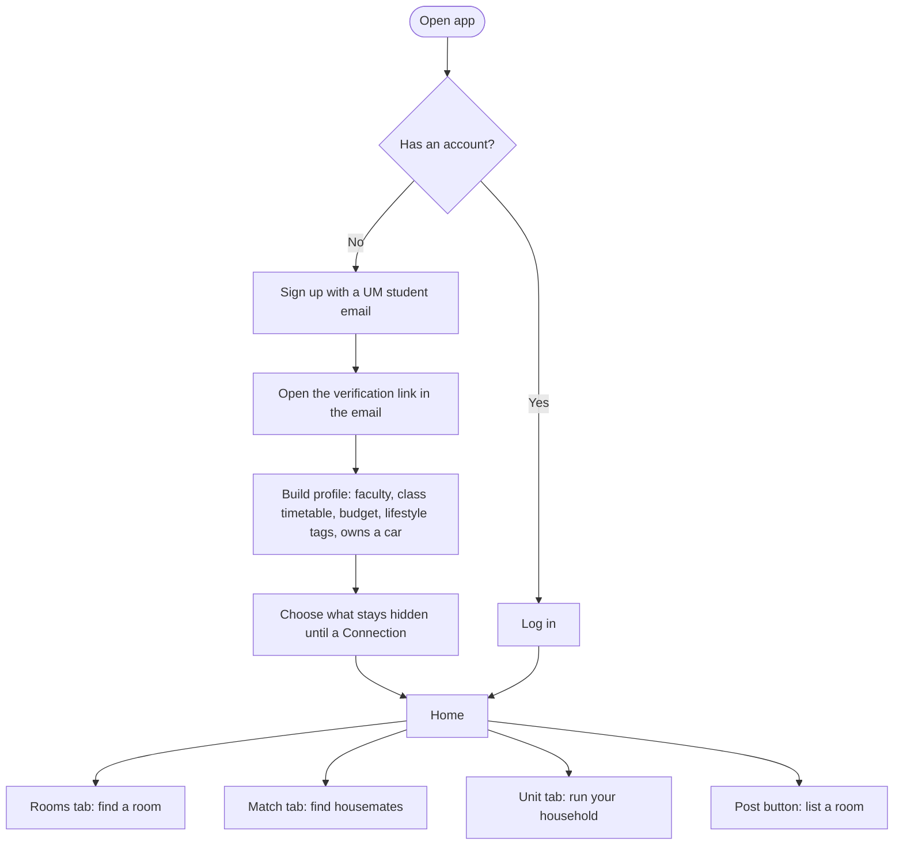
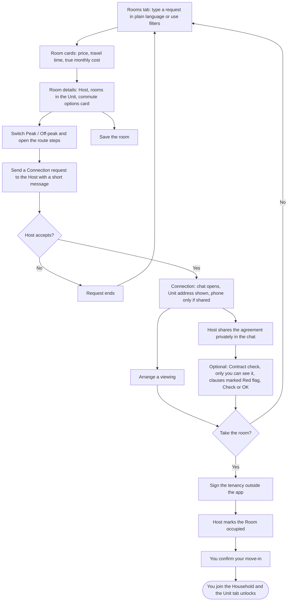
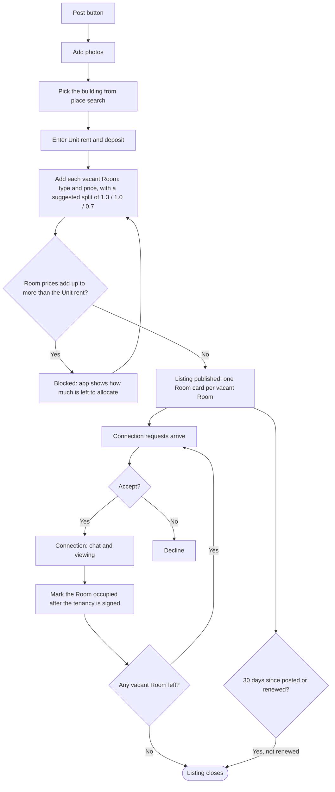
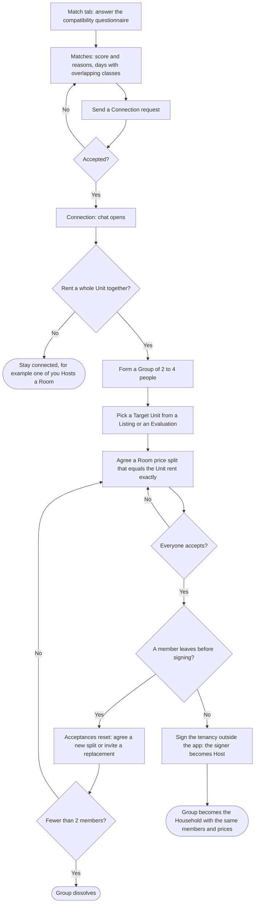
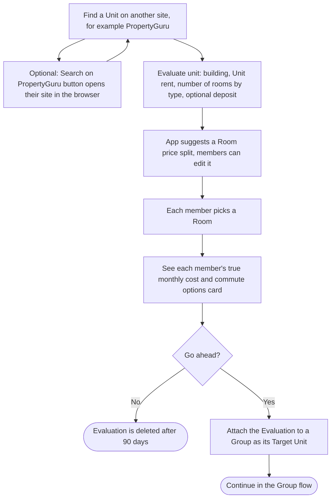
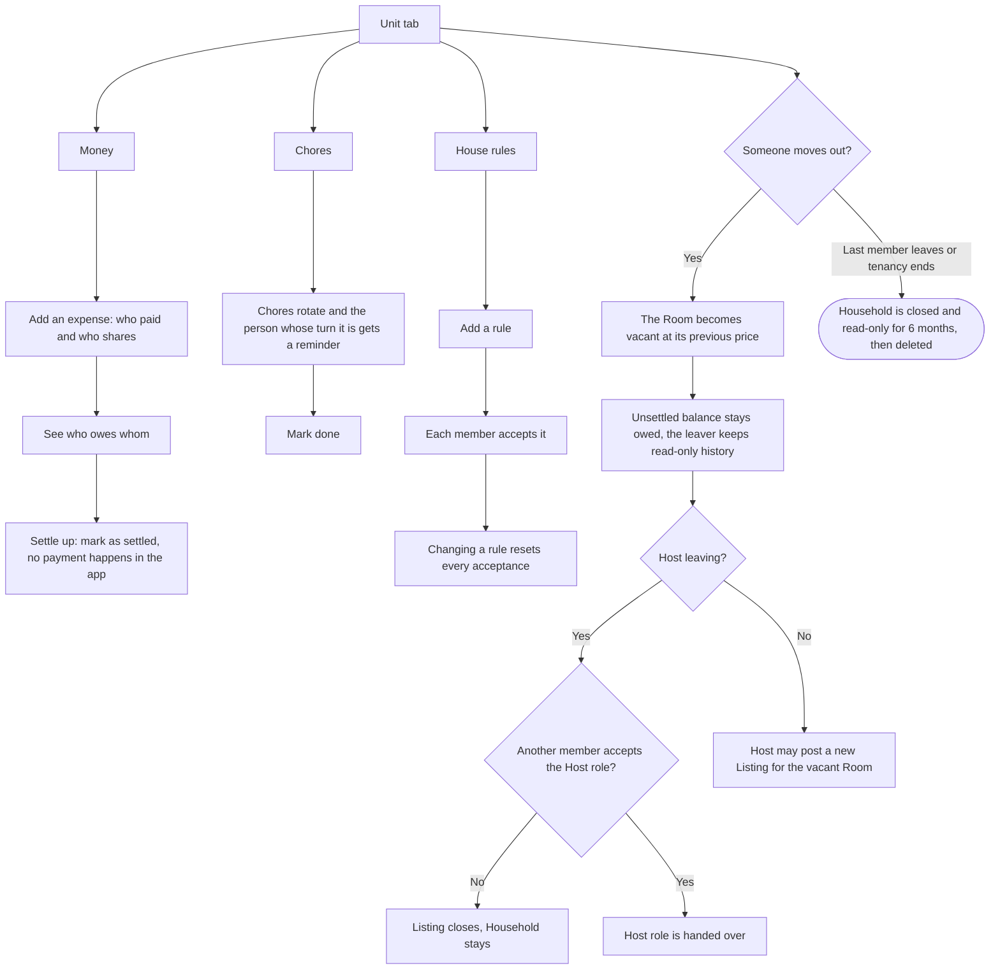
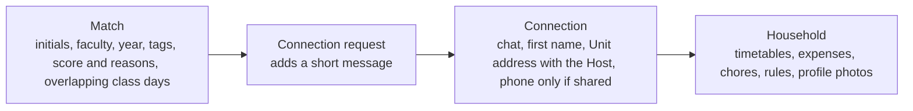

# Jiran: User Flows

Flowcharts of how a student moves through the app. Terms follow [GLOSSARY.md](GLOSSARY.md) and rules follow [PRD.md](PRD.md). The charts are Mermaid, so GitHub draws them directly.

Legend: rounded boxes are start or end points, diamonds are decisions, plain boxes are screens or actions.

## 1. Getting started

## 2. Find a room and move in

## 3. Host posts a Listing

## 4. Housemates: Match, Group and Household

## 5. Found a Unit elsewhere: Evaluate unit

## 6. Living together: the Unit tab

## 7. What unlocks at each stage

A Match on its own never unlocks anything. Users can hide any field at every stage in their privacy settings.

## One student's story (Mei Ling)

1. Signs up with her UM email and fills in her timetable (flow 1).
2. Searches "room under RM550, 30 min to FSKTM by train" and reads the Room cards (flow 2).
3. Opens a Room, sees the true monthly cost and the LRT plus shuttle route, and checks the tenancy agreement (flow 2).
4. The Host accepts her Connection request, they view the room and she moves in (flow 2).
5. In the Unit tab the household splits rent by Room price, adds bills, rotates chores and agrees house rules (flow 6).
