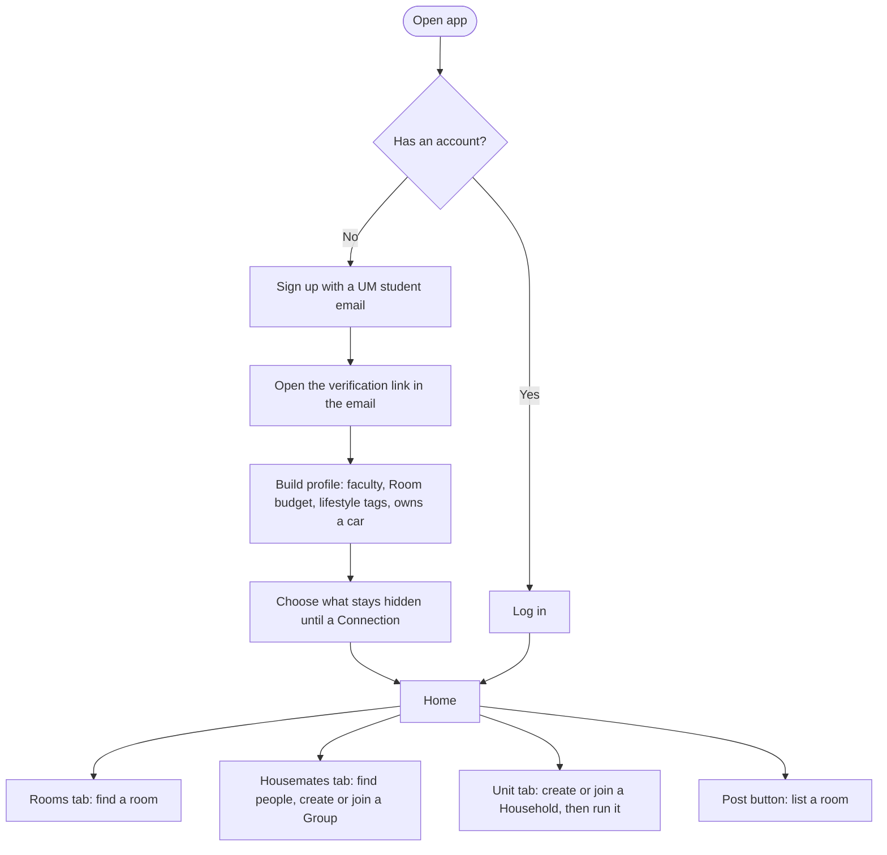
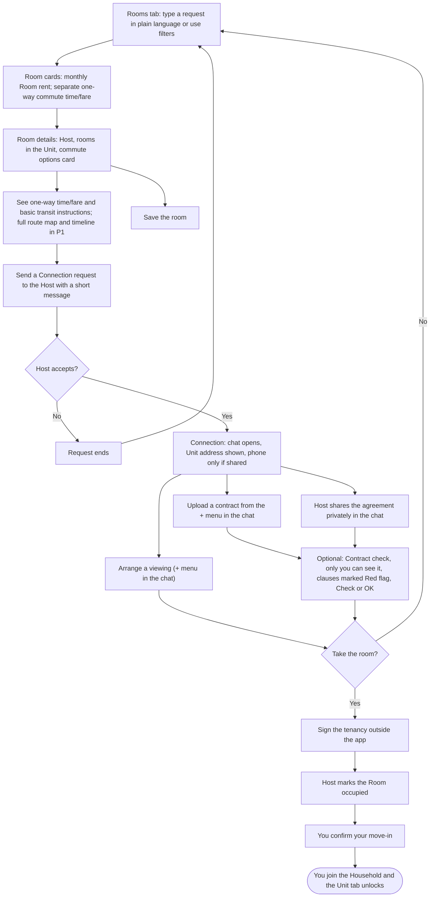
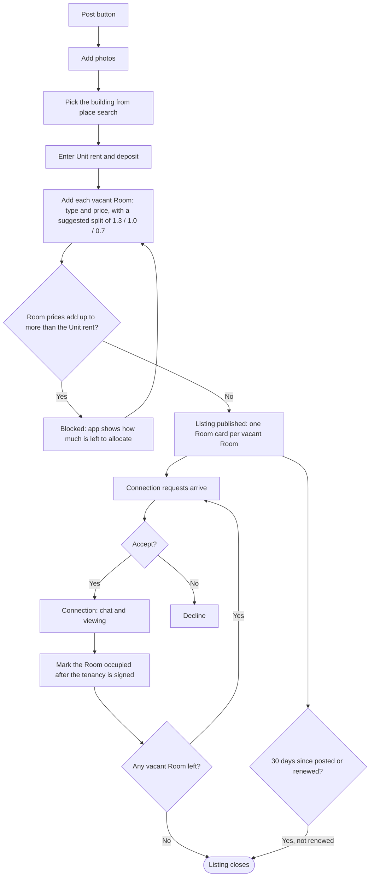
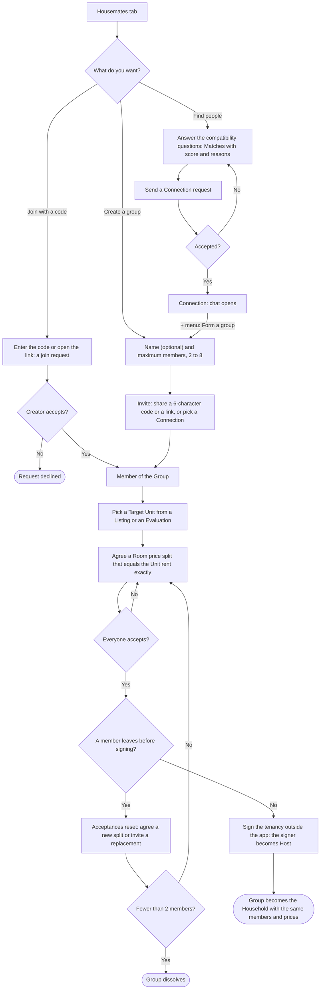
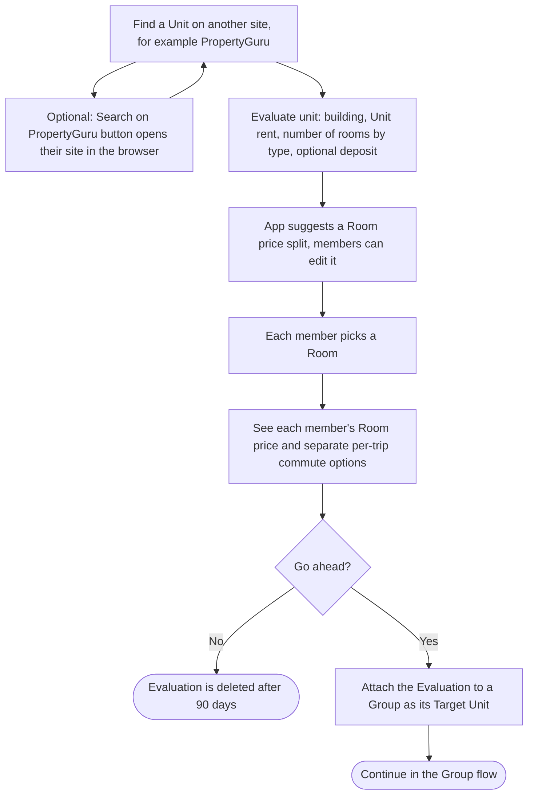
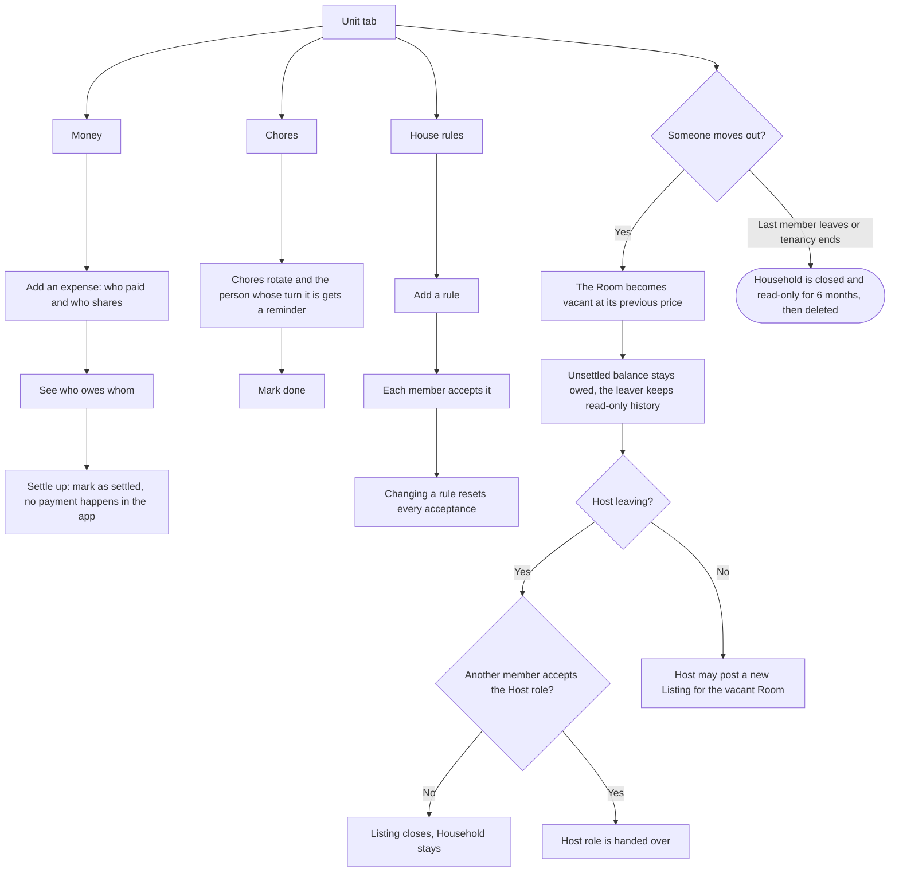
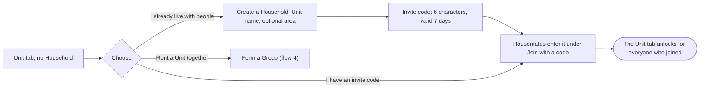
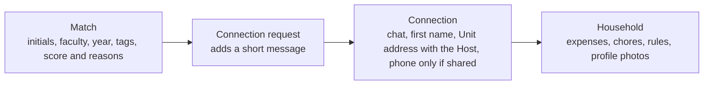

# Jiran: User Flows

Flowcharts of how a student moves through the app. Terms follow [GLOSSARY.md](GLOSSARY.md) and rules follow [PRD.md](PRD.md). The charts are Mermaid, so GitHub draws them directly.

Legend: rounded boxes are start or end points, diamonds are decisions, plain boxes are screens or actions.

## 1. Getting started

## 2. Find a room and move in

No timetable or campus-day count is needed. The origin is the Listing being considered; the destination is the profile faculty. Monthly commute totals and true monthly cost are removed (PRD FR4.1–4.3, Ary, 11 Nov 2026).

## 3. Host posts a Listing

## 4. Housemates: find people, create or join a Group, then a Household

The Housemates tab holds everything about finding housemates. A student with no Group sees **Create a group** and **Join with a code** above the Match list; a student in a Group sees a "Your group" card (members, status, spots left, Open group) and the list below it is for filling the remaining spots; a full Group hides the list. A Group has two to eight members, set by its creator. A student is in one Group at a time, so "Form a group" becomes "Open group" in the chat + menu and the Unit tab. A join request needs the creator's acceptance; joining does not open contact details (those still need a Connection).

## 5. Found a Unit elsewhere: Evaluate unit

## 6. Living together: the Unit tab

### Starting a Household without a Listing

## 7. What unlocks at each stage

A Match on its own never unlocks anything. Users can hide any field at every stage in their privacy settings.

## One student's story (Mei Ling)

1. Signs up with her UM email and builds her profile (flow 1).
2. Searches "room under RM550, 30 min to FSKTM by train" and reads the Room cards (flow 2).
3. Opens a Room, sees monthly rent separately from one-way fares and how to travel by LRT plus shuttle, and checks the tenancy agreement (flow 2).
4. The Host accepts her Connection request, they view the room and she moves in (flow 2).
5. In the Unit tab the household splits rent by Room price, adds bills, rotates chores and agrees house rules (flow 6).
